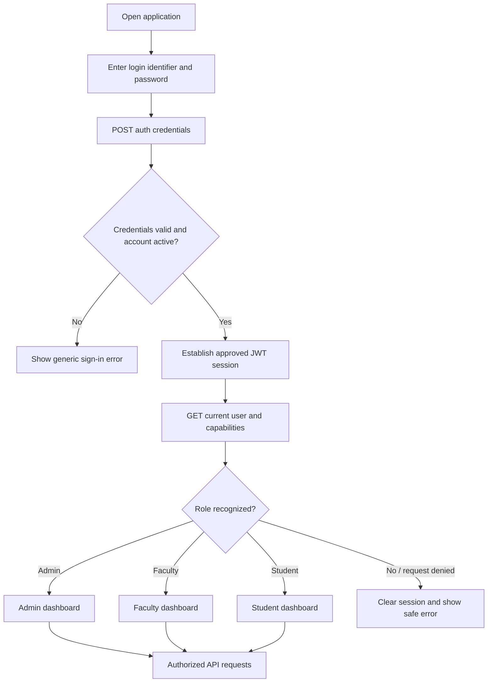

# Smart College Management System — User Workflows

**Requirements reference:** `docs/SRS.md`  
**Document status:** Phase 01 subprompt 1.1 — workflow design  
**Version:** 1.0  
**Date:** 2026-11-07

> This document describes user journeys and logical API interactions, not an API contract or implementation. Endpoint names are illustrative resource/action names under `/api/v1/`; request/response schemas, HTTP methods, pagination, and exact error codes will be finalized in API design. All authorization is enforced by the backend, including record-level scope.

## 1. Shared sign-in and session workflow

### Login process

1. User opens the application and enters their institutional login identifier and password.
2. Frontend submits credentials over HTTPS to the authentication API.
3. Backend validates the credentials, account state, and applicable access policy. Credentials are checked using Django's password hashing; plaintext passwords are never returned or logged.
4. On success, the client establishes the authenticated session using the selected JWT access/refresh-token strategy and requests the current user's profile and permissions. Token storage and refresh protections are architecture decisions and must be designed to mitigate XSS and CSRF risks.
5. The frontend routes the user to the dashboard appropriate to the backend-provided role. Hiding a route or button is only a usability measure; the API independently authorizes each request.
6. On sign-out, the client clears its session and asks the backend to revoke/blacklist the refresh token if revocation is enabled.

### Logical API interactions

- `POST /api/v1/auth/token/` — authenticate with credentials; illustrative only.
- `POST /api/v1/auth/token/refresh/` — obtain a refreshed access token if permitted.
- `POST /api/v1/auth/logout/` — revoke/blacklist a refresh token where supported.
- `GET /api/v1/auth/me/` — return the authenticated user's profile and role-safe capabilities.

### Alternatives and errors

- Invalid credentials: show a generic sign-in failure without revealing whether an account exists.
- Inactive/deactivated account: deny access, return a safe message, and do not issue a usable session.
- Expired access token: attempt the approved refresh flow; if refresh fails, clear session and return to sign-in.
- Revoked/invalid refresh token: clear local session and require sign-in.
- Network/service unavailable: retain no false authenticated state; show a retryable error.
- Unauthenticated API request: backend returns an authentication error; frontend directs the user to sign in.
- Authenticated but unauthorized request: backend denies access without exposing protected record details.

## 2. Administrator workflows

### 2.1 Dashboard functions

The administrator dashboard may provide authorized summaries and shortcuts for:

- student, faculty, department, program/course, subject, academic year, and semester management;
- enrollment and faculty assignment status;
- attendance summaries and threshold alerts;
- examination setup, result review queues, and publication status;
- timetable and conflict review;
- fee structures, charges, manually recorded payments, balances, and receipt lookup;
- announcements and notification status;
- reports and audit history.

Every dashboard count and list must be computed from authorized backend data. Administrative capability does not automatically grant access to secrets such as passwords or JWTs.

### 2.2 User and academic setup

**Main workflow**
1. Admin opens user/academic management and retrieves the permitted list.
2. Admin creates or updates departments, programs, subjects, academic periods, student/faculty profiles, and accounts in dependency order.
3. Admin assigns faculty to offerings and enrolls students in valid periods/subjects.
4. Backend validates required fields, unique institutional identifiers, active status, relationships, and applicable period constraints.
5. Successful changes are persisted, audited where required, and reflected in lists and rosters.

**Logical API interactions**
- `GET/POST /api/v1/departments/`
- `GET/POST /api/v1/programs/`
- `GET/POST /api/v1/subjects/`
- `GET/POST /api/v1/academic-years/` and `/semesters/`
- `GET/POST /api/v1/users/`, `/students/`, `/faculty/`
- `GET/POST /api/v1/offerings/`, `/faculty-assignments/`, `/enrollments/`
- `PATCH /api/v1/.../{id}/` — illustrative update operation.

**Restrictions**: only authorized admins can create or change institutional structure and other users' roles/profiles. Deletion of referenced records should be prevented; archival/deactivation preserves history. Every target ID is checked by the backend.

**Alternatives/errors**: duplicate identifier/code, missing parent record, invalid date range, inactive account, duplicate enrollment, or referenced-record deletion attempt returns validation/conflict feedback without partial persistence. A network failure should not display a success confirmation unless the API confirms the transaction.

### 2.3 Configure academic rules

1. Admin selects scope and effective academic period.
2. Admin enters attendance threshold/status policy, grading bands, and minimum passing marks.
3. Backend validates bounds, non-overlapping grade ranges, valid marks scale, and an unambiguous active rule for that scope.
4. Admin saves; system versions/audits the configuration. Existing published results retain the rule version used.

**Logical API interactions**: `GET/POST /api/v1/academic-rules/`, `/attendance-policies/`, `/grading-scales/`; illustrative only.

**Restrictions**: only an authorized admin can change rules. Retroactive alteration of a published result's rule is not an ordinary edit; it requires an explicitly authorized correction workflow.

**Alternatives/errors**: overlapping bands, invalid threshold, duplicate/conflicting active configuration, or incompatible pass marks are rejected with field-level feedback.

### 2.4 Examination result approval and publication

1. Admin creates an examination for an offering and period and specifies maximum marks and applicable rules.
2. Faculty enters marks for students in their assigned offering and submits the result set for review.
3. Admin/reviewer opens the review queue, inspects completeness and validation summaries, and either returns it for correction or approves it.
4. Authorized admin publishes the approved result set. Publication is atomic, audit logged, and student-visible only after success.
5. System creates in-app result-publication notifications for affected students.

**Logical API interactions**: `GET/POST /api/v1/examinations/`; `GET /api/v1/results/review-queue/`; `POST /api/v1/results/{id}/submit/`, `/review/`, `/approve/`, `/publish/`; `GET /api/v1/results/{id}/`.

**Restrictions**: faculty may enter results only for assigned offerings; reviewers/approvers require explicit permission; students cannot query drafts or review data. Separation between reviewer and approver remains a policy decision.

**Alternatives/errors**: invalid/out-of-range marks, incomplete roster, result returned for correction, unauthorized approver, illegal state transition, or publication transaction failure. On failure, the result must remain unpublished as a whole; no partial student visibility.

### 2.5 Timetable management

Admin creates or updates schedule entries for an offering, faculty, room, group, and time range. Backend checks time validity, period bounds, and prohibited faculty/room/group conflicts. Admin reviews conflicts and revises the entry; successful changes become visible in role-scoped schedules. Reschedules/cancellations may generate notifications.

**Logical API interactions**: `GET/POST /api/v1/timetable/`; `GET /api/v1/timetable/conflicts/`; `PATCH/POST /api/v1/timetable/{id}/...` (illustrative).

Errors include conflicting interval, invalid academic reference, missing assignment, or unauthorized request. The server—not a client-side calendar check—is authoritative.

### 2.6 Fees and manual payment recording

1. Admin/authorized finance operator configures a fee structure and applies a charge to a student.
2. Operator finds the charge and confirms the current balance.
3. Operator records a positive amount, date, Cash/UPI/Bank Transfer method, and method-appropriate reference/details.
4. Backend rechecks balance and permission at save time, persists payment and receipt reference transactionally, and recalculates pending balance.
5. Operator provides the generated receipt; student can view their own charges and payment history.

**Logical API interactions**: `GET/POST /api/v1/fee-structures/`, `/api/v1/charges/`; `GET /api/v1/charges/{id}/balance/`; `POST /api/v1/payments/`; `GET /api/v1/payments/{id}/receipt/`.

**Restrictions**: only authorized finance/admin users record payments or adjustments; students can view only their own financial records. MVP does not call an external payment gateway. Payments are corrected through an audited adjustment/reversal, not silent deletion.

**Alternatives/errors**: partial payment leaves pending balance; amount greater than balance is rejected under the current SRS assumption; concurrent payment causes a balance recheck/conflict; invalid method/reference or receipt failure must not result in a false success. Refund/overpayment policies remain to be confirmed.

### 2.7 Announcements, reporting, and audit review

Authorized admin drafts and targets an announcement, previews audience, then publishes. The backend validates publisher and audience and creates in-app notifications. Admin may inspect authorized reports and audit events, but cannot alter immutable audit history. Invalid target audience, empty content, unauthorized publication, or duplicate event processing is handled safely.

**Logical API interactions**: `GET/POST /api/v1/announcements/`; `POST /api/v1/announcements/{id}/publish/`; `GET /api/v1/reports/...`; `GET /api/v1/audit-events/`.

## 3. Faculty workflows

### 3.1 Dashboard functions

Faculty dashboard provides assigned subjects/classes, relevant timetable, enrolled rosters, attendance tasks/alerts, examination and marks tasks, review feedback, and scoped academic reports. It does not expose unassigned classes, unrelated students, administrative configuration, fee management, or other faculty members' private data unless explicitly granted.

### 3.2 View assignments and rosters

Faculty signs in, opens assigned classes, and retrieves current assignments and associated enrolled students. Backend derives scope from the authenticated faculty identity; user-supplied faculty/student IDs cannot expand access. Assignment changes by an admin appear in the next authorized query.

**Logical API interactions**: `GET /api/v1/faculty/me/assignments/`; `GET /api/v1/offerings/{id}/students/`; `GET /api/v1/timetable/me/`.

Errors: no active assignment yields an empty state; stale assignment or arbitrary offering ID is denied/not found safely; inactive faculty account cannot continue a usable session.

### 3.3 Record attendance

1. Faculty selects an assigned offering and a valid class session.
2. System displays the eligible roster and session state.
3. Faculty records configured attendance status for each student and saves a draft or finalizes the roll call.
4. Backend verifies assignment, enrollment, session eligibility, status values, and uniqueness; finalized attendance feeds the eligible-session percentage calculation.
5. Students see their own updated attendance; threshold alerts are generated according to policy.

**Logical API interactions**: `GET /api/v1/offerings/{id}/sessions/`; `POST /api/v1/sessions/`; `GET /api/v1/sessions/{id}/attendance/`; `PUT/POST /api/v1/sessions/{id}/attendance/`; `POST /api/v1/sessions/{id}/finalize/`.

**Restrictions**: faculty can only mark assigned offerings and enrolled students. Post-finalization edits require authorized correction and audit; frontend permissions are not authoritative.

**Alternative/error scenarios**: session cancelled/not held, future date, student not enrolled, duplicate attendance, invalid status, concurrent update, or network failure. The system should preserve a clear unsaved state and not count an unfinalized roll call as eligible. Missing entries are not silently converted to absence unless an approved policy says so.

### 3.4 Enter and submit examination marks

Faculty opens an assigned examination, receives its eligible roster and maximum marks, enters marks, validates completion, saves draft, and submits for review. Backend rejects out-of-range values and scope violations and records submission state. Faculty can address review feedback and resubmit if returned. Faculty cannot approve or publish unless separately granted explicit authority.

**Logical API interactions**: `GET /api/v1/examinations/{id}/roster/`; `GET/POST /api/v1/examinations/{id}/marks/`; `POST /api/v1/results/{id}/submit/`; `GET /api/v1/results/{id}/review-feedback/`.

Errors include closed/invalid exam, non-enrolled student, incomplete data if completeness is required, maximum-mark violation, stale result state, or unauthorized offering. Draft/review results are not visible to students.

### 3.5 Review assigned-class reports

Faculty filters reports by assigned period/offering. Backend applies faculty scope to every query and returns authorized attendance and examination summaries. Attempts to query other departments/classes are denied; empty datasets are presented as empty states rather than fabricated values.

## 4. Student workflows

### 4.1 Dashboard functions

Student dashboard shows personal profile summary, own timetable, attendance percentage and alerts, published results, fee charges/balance/payment history, and in-app announcements/notifications. Draft marks, other students' records, staff-only comments, and administrative controls are excluded.

### 4.2 View profile and academic enrollment

Student signs in and requests their profile and enrollment information. The API identifies the student through the authenticated account, not a client-provided student ID. If profile correction is not enabled, student contacts administration through the college's designated process; editing another person's data is never permitted.

**Logical API interactions**: `GET /api/v1/students/me/`; `GET /api/v1/enrollments/me/`.

Errors: missing profile mapping is reported safely for administrative resolution; unauthorized IDs cannot be used to enumerate other records.

### 4.3 View attendance

Student opens attendance for a period/subject and sees recorded sessions, percentage, and threshold status. The backend calculates percentage using eligible finalized sessions and the applicable rule version. Student may report a discrepancy through an approved process, but cannot edit attendance.

**Logical API interactions**: `GET /api/v1/attendance/me/`; `GET /api/v1/attendance/me/summary/`; optionally `POST /api/v1/attendance/discrepancy-reports/` if approved for MVP.

Errors: no eligible sessions produces an explicitly defined not-yet-available state rather than a misleading 0%; absent data is not reinterpreted by the client.

### 4.4 View results

Student opens results; backend returns only results whose publication state is published and whose student scope matches. Student receives an in-app notification on publication. Draft/review records and internal review comments remain hidden.

**Logical API interactions**: `GET /api/v1/results/me/`; `GET /api/v1/results/{id}/` after ownership and publication checks.

Errors: unpublished or unrelated result is denied/not found without confirming another student's record exists; no published results displays an empty state.

### 4.5 View timetable

Student requests the schedule for their enrolled group and period. Backend derives the allowed group from enrollment and returns current schedule, including approved changes/cancellations. Student cannot query private schedules outside their enrollment.

**Logical API interaction**: `GET /api/v1/timetable/me/`.

Errors: no current schedule, cancelled entry, invalid period, or request for another group is handled with a safe empty/denied response.

### 4.6 View fees, payments, and receipts

Student opens fee summary and sees own charges, amounts paid, pending balance, and payment history. Student can view/download receipts associated with their own recorded payments but cannot create or edit payment records in MVP.

**Logical API interactions**: `GET /api/v1/fees/me/`; `GET /api/v1/payments/me/`; `GET /api/v1/payments/{id}/receipt/`.

Errors: another student's charge/receipt is denied; receipt not found or unavailable produces a safe message; displayed balance is sourced from the backend.

### 4.7 Notifications and announcements

Student opens notifications, retrieves only their recipient records, filters unread items, and marks selected notification(s) read. College/exam announcements are shown only when targeted to the student. Email/SMS delivery is not part of MVP.

**Logical API interactions**: `GET /api/v1/notifications/`; `POST /api/v1/notifications/{id}/read/`; `POST /api/v1/notifications/read-all/` if supported.

Errors: attempts to mark another user's notification read are denied; withdrawn/expired announcements follow the configured visibility policy.

## 5. Cross-cutting permission and error behavior

- All authenticated API operations verify role and object-level scope on the backend.
- Client-supplied IDs, filters, and role labels never grant access.
- List endpoints must be scoped before pagination/filtering to avoid data leakage through counts or search.
- Draft/review results are inaccessible to students; financial details and student profiles are private to the record owner and authorized staff.
- Mutations that affect balances, final attendance, result publication, or academic rules require transactional persistence and appropriate audit records.
- Validation errors should identify correctable fields without leaking protected record existence. Authentication and authorization errors should be consistent and safe.
- On network failure, clients must distinguish unknown submission outcome from confirmed failure and avoid blind duplicate payment/result submissions; operation identifiers/idempotency behavior will be defined in API design.

## 6. Workflow acceptance checklist

- [x] Login, role-based landing, token/session failure paths, and safe authorization behavior described.
- [x] Admin, faculty, and student dashboard capabilities and restrictions documented.
- [x] Major role-specific workflows include preconditions, API interaction categories, restrictions, and alternative/error cases.
- [x] Attendance finalization and eligible-session calculation behavior are represented.
- [x] Result draft/review/approval/publication visibility is represented.
- [x] Manual payment, partial balance, receipt, and failure handling are represented.
- [x] In-app announcement/notification flows are represented.
- [x] Mermaid flowcharts are included for shared login and key administrative/faculty/student workflows.
- [x] No application code is generated; endpoint labels remain illustrative and subject to API design.
- [ ] Stakeholders confirm unresolved policies called out in `docs/SRS.md` before affected implementation.

**Next dependency:** after workflow review, Phase 02 architecture/API design should map these journeys to concrete services, endpoint contracts, permission policies, and state transitions.
